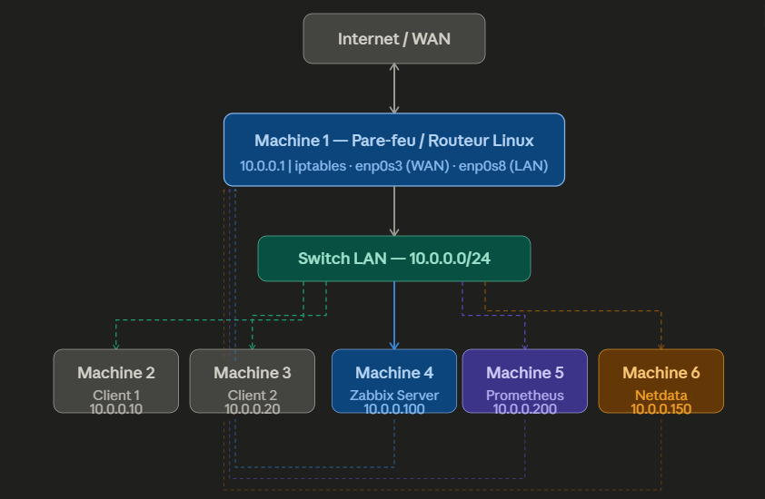
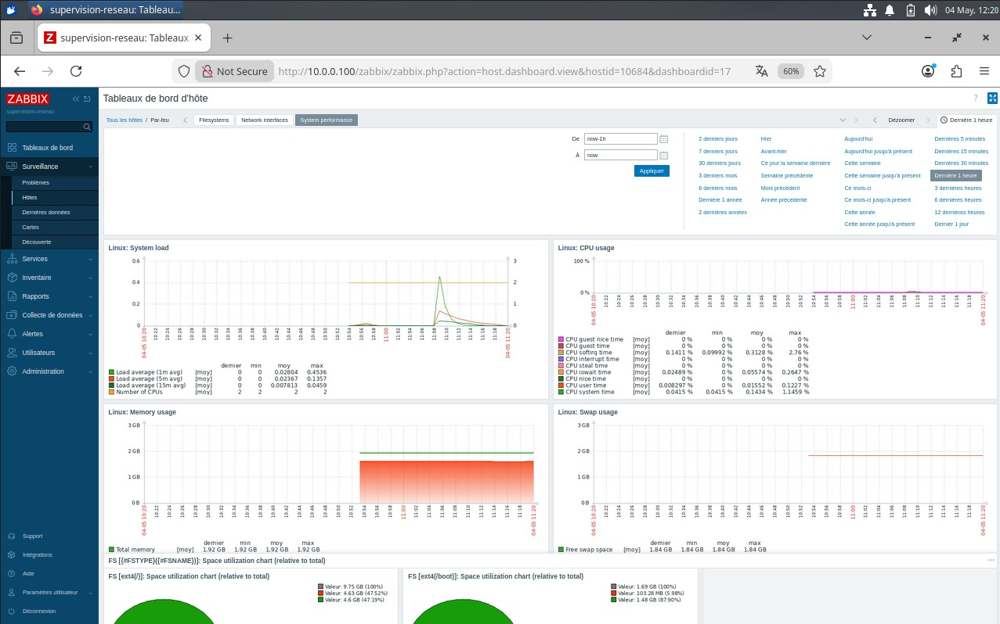
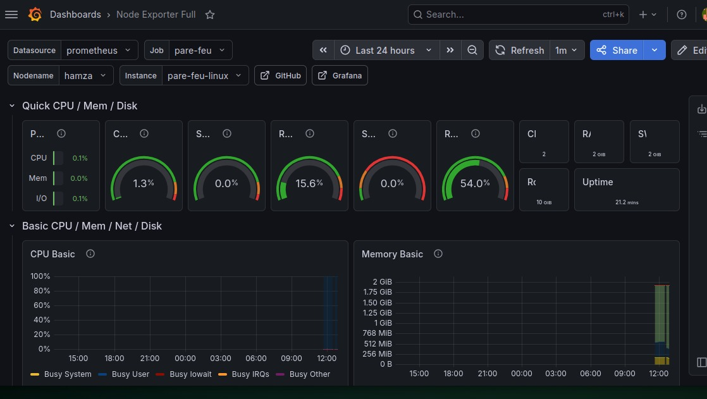
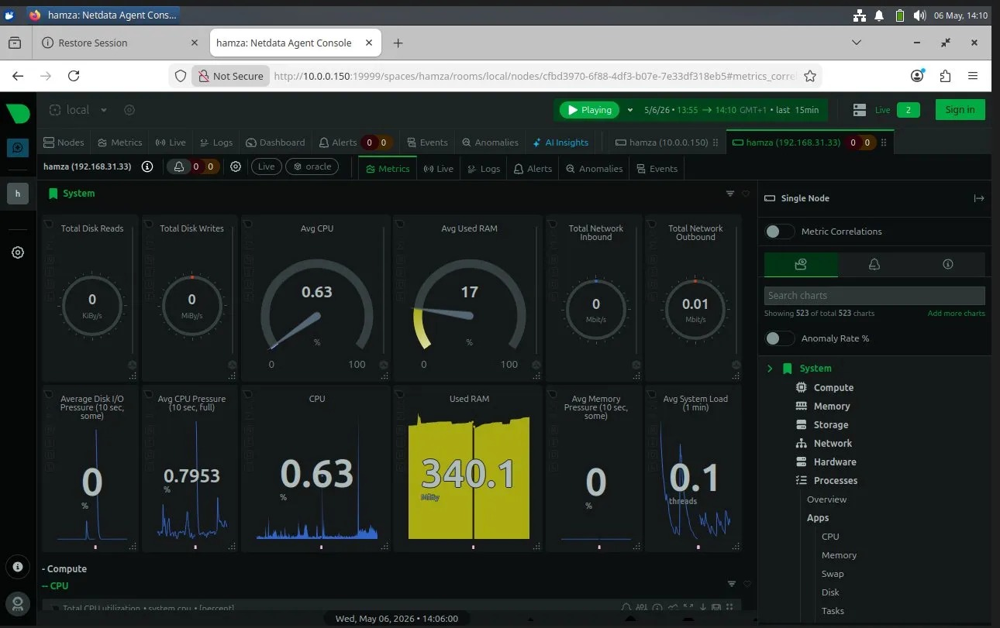
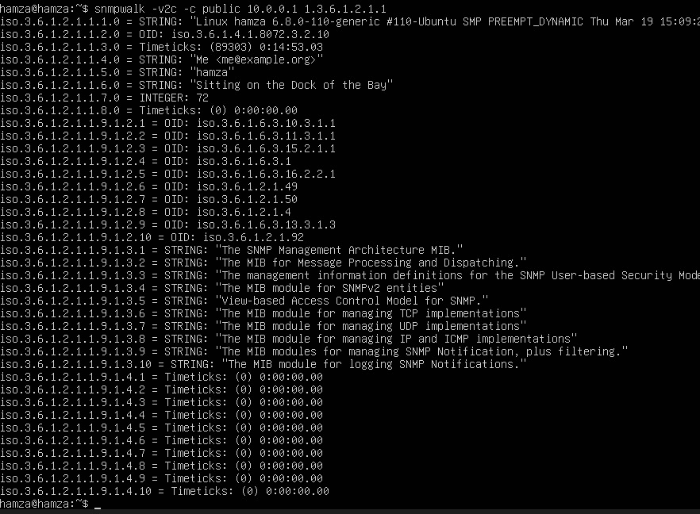
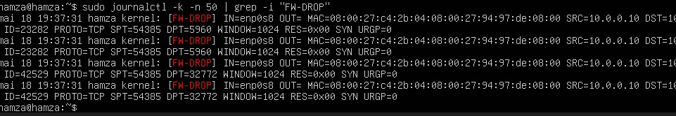

# 🛡️ Supervision d'un Pare-feu / Routeur Linux dans un Mini-Réseau

Mise en place et comparaison de **trois solutions de supervision** — **Zabbix**, **Prometheus + Grafana** et **Netdata** — pour surveiller un pare-feu Linux (iptables) dans un mini-réseau de 6 machines virtuelles VirtualBox.


---

##  Problématique

Les routeurs et pare-feux sont au cœur du réseau. **Comment superviser efficacement un pare-feu Linux** pour suivre son état, sa charge et les événements de sécurité qu'il génère ?

##  Architecture



| Machine | Rôle | IP | Services | Ports |
|---|---|---|---|---|
| Machine 1 | Pare-feu / Routeur | 10.0.0.1 | iptables, Zabbix Agent, Node Exporter, Netdata, snmpd | 10050, 9100, 19999, 161 |
| Machine 2 | Client 1 | 10.0.0.10 | — | — |
| Machine 3 | Client 2 | 10.0.0.20 | — | — |
| Machine 4 | Serveur Zabbix | 10.0.0.100 | Zabbix Server, MySQL, Apache | 80, 10050, 10051 |
| Machine 5 | Prometheus + Grafana | 10.0.0.200 | Prometheus, Grafana | 9090, 3000 |
| Machine 6 | Netdata | 10.0.0.150 | Netdata (parent) | 19999 |

**Réseau :** LAN `10.0.0.0/24` — le pare-feu route vers Internet via NAT (interface WAN `enp0s3`, LAN `enp0s8`).

## 📁 Structure du dépôt

```
├── firewall/              # Règles iptables, journalisation, Netplan, IP forwarding
├── snmp/                  # Configuration snmpd + test snmpwalk
├── zabbix/                # Base MySQL, config serveur et agent
├── prometheus-grafana/    # prometheus.yml, services systemd, Node Exporter
├── netdata/               # Streaming parent/enfant
├── tests/                 # Démonstration de détection d'un scan de ports
├── screenshots/           # Captures d'écran par outil

```

##  1. Pare-feu Linux (iptables)

- Routage IP activé (`net.ipv4.ip_forward = 1`)
- Politique par défaut **DROP** sur INPUT et FORWARD
- NAT (MASQUERADE) pour l'accès Internet des clients
- Ports de supervision ouverts **uniquement** depuis les serveurs concernés
- Journalisation des paquets bloqués (`[FW-DROP]`) et des nouvelles connexions (`[IPTABLES-ACCEPT]`)

```bash
sudo ./firewall/iptables-rules.sh
sudo ./firewall/iptables-logging.sh
```

##  2. Zabbix

Hôte `Par-feu` supervisé via l'agent Zabbix (template *Linux by Zabbix agent*) + SNMP v2c, avec triggers sur CPU > 80 %, disque faible et hôte injoignable.



| Métrique | Valeur observée |
|---|---|
| CPU | 1,3 % |
| RAM | 54 % (1,1 GB / 2 GB) |
| Disque / | 47,5 % |
| Interfaces | WAN + LAN supervisées |

##  3. Prometheus + Grafana

Node Exporter sur le pare-feu, scrape toutes les **15 s**, dashboard Grafana **Node Exporter Full (ID 1860)**.



##  4. Netdata

Streaming **parent/enfant** : le pare-feu envoie ses métriques en temps réel à la Machine 6. Environ **3 000 métriques** et **523 graphiques** générés automatiquement, granularité **1 seconde**.



##  5. SNMP

SNMP v2c configuré sur le pare-feu et validé par `snmpwalk` depuis le serveur Zabbix.



##  Comparaison des trois outils

| Critère | Zabbix | Prometheus + Grafana | Netdata |
|---|---|---|---|
| Architecture | Agent + SNMP + MySQL | Pull / Scrape + TSDB | Agent streaming + RAM |
| Interface web | Intégrée complète | Grafana (la meilleure) | Dashboard automatique |
| Granularité | 1–5 min (configurable) | 15 s (défaut) | **1 s (temps réel)** |
| Alertes | **Intégrées et complètes** | Alertmanager séparé | Health checks auto |
| Support SNMP | **Natif et complet** | Via exporteur | Non supporté |
| Consommation RAM | Élevée (MySQL) | Moyenne | **Faible** |
| Courbe d'apprentissage | Élevée | Moyenne | **Faible** |
| Cas d'usage idéal | Infrastructure IT entreprise | Cloud / DevOps / K8s | Supervision rapide Linux |

##  Démonstration : détection d'un scan de ports

Un scan `nmap -sS` lancé depuis Client 1 vers le pare-feu est immédiatement visible dans les journaux `[FW-DROP]` : paquets SYN depuis la même source vers de nombreux ports différents.



 Détails : [tests/demo-scan-ports.md](tests/demo-scan-ports.md)

##  Conclusion

**Zabbix** est l'outil le plus adapté à la supervision d'un pare-feu dans ce contexte : support SNMP natif, système d'alertes mature et polyvalence multi-protocoles.

Les trois outils restent **complémentaires** en production :
- **Zabbix** → supervision globale et centralisation des alertes
- **Prometheus + Grafana** → visualisation avancée, environnements cloud/DevOps
- **Netdata** → débogage en temps réel, anomalies fugaces

##  Note de sécurité

Ce projet est un **environnement de laboratoire**. Les mots de passe ont été remplacés par `CHANGE_ME` et la clé Netdata est un exemple. En production, il faudrait notamment utiliser SNMPv3, restreindre l'accès SSH et générer des clés uniques.


##  Auteur

- **Hamza Bencheikh**

##  Références

- [Documentation Zabbix](https://www.zabbix.com/documentation)
- [Documentation Prometheus](https://prometheus.io/docs)
- [Documentation Grafana](https://grafana.com/docs)
- [Documentation Netdata](https://learn.netdata.cloud)
- [Netfilter / iptables](https://netfilter.org)
