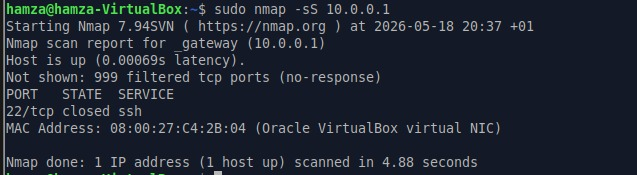
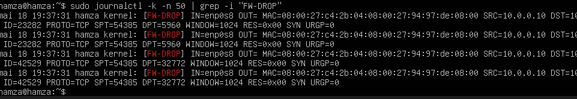

# Démonstration : détection d'un scan de ports

| Rôle | Machine |
|---|---|
| Attaquant | Client 1 — 10.0.0.10 |
| Cible | Pare-feu — 10.0.0.1 |
| Outil | nmap 7.94 |

## 1. Lancer le scan (depuis Client 1)
```bash
sudo nmap -sS 10.0.0.1
```
Résultat : 999 ports filtrés, seul le port 22 répond → la politique DROP est efficace.

## 2. Détecter le scan (sur le pare-feu)
```bash
sudo journalctl -k -n 50 | grep -i "FW-DROP"
```
Les journaux montrent des paquets `SYN` depuis `SRC=10.0.0.10` vers de nombreux ports différents (`DPT=5960`, `DPT=32772`…) : signature typique d'un scan SYN.




## Tests de connectivité
- Ping Client 1 ↔ Client 2 : OK
- Ping clients → Internet (NAT du pare-feu) : OK
